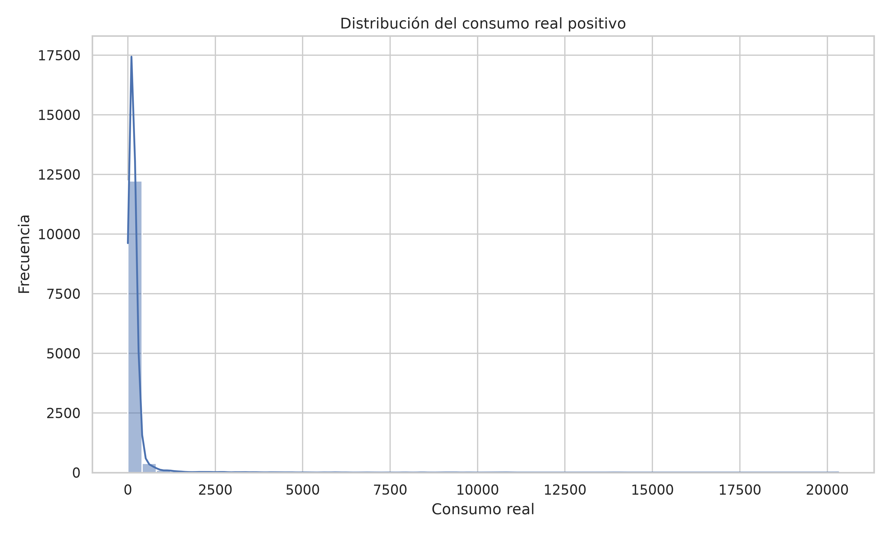
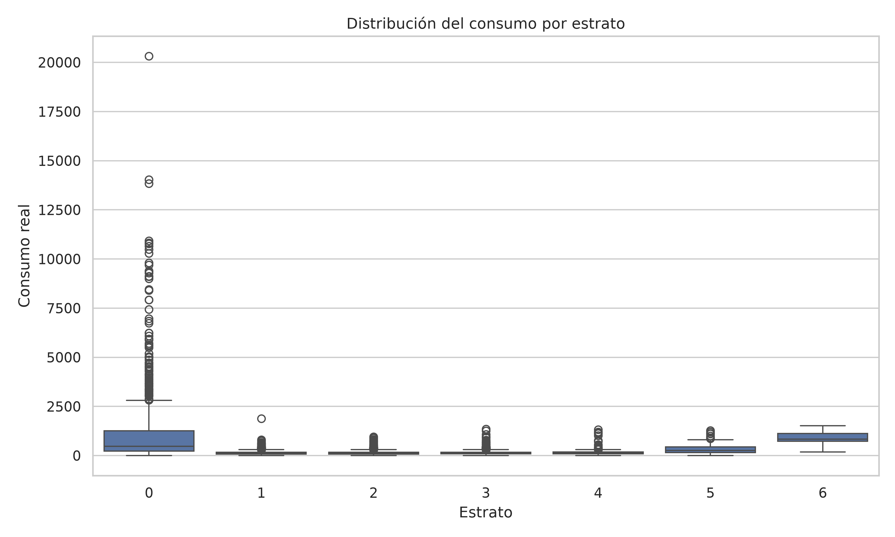
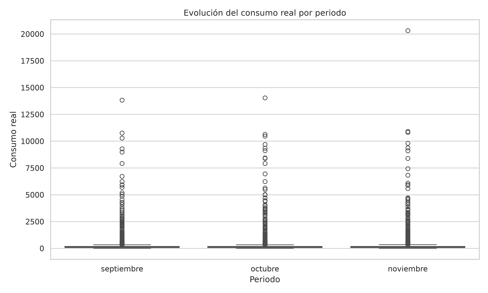
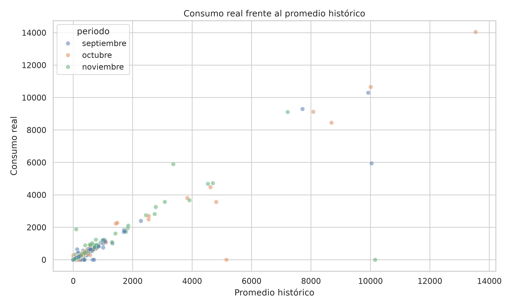
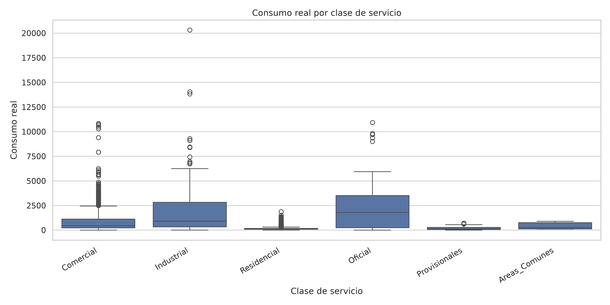
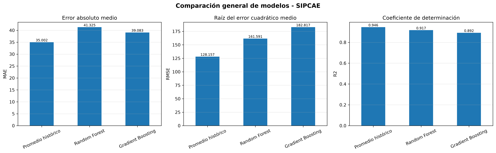
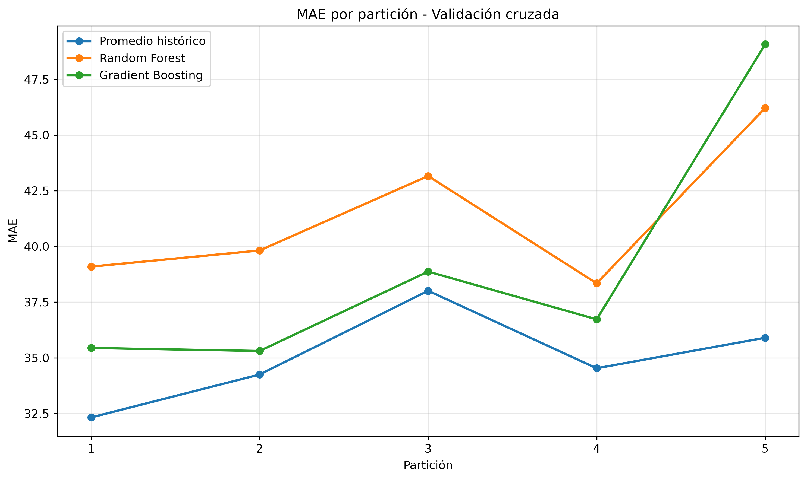
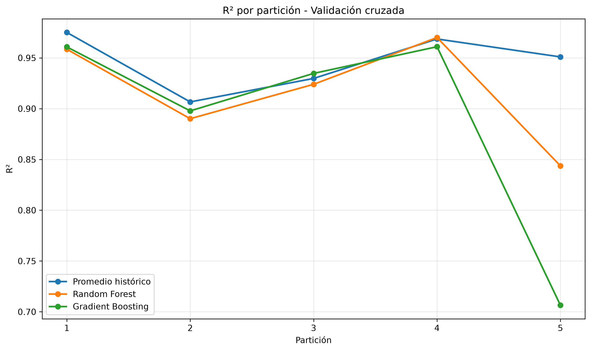

# SIPCAE
## Sistema Inteligente de Predicción y Control de Anomalías Energéticas

SIPCAE es un proyecto académico de Inteligencia Artificial orientado al análisis de consumos eléctricos y la identificación de comportamientos atípicos mediante técnicas de análisis de datos, aprendizaje automático y detección estadística de anomalías.

El proyecto trabaja con registros históricos de consumo correspondientes a tres periodos mensuales de usuarios del servicio de energía eléctrica en Cartago, Valle del Cauca, Colombia.

## 1. Objetivos

### Objetivo general

Desarrollar un sistema inteligente que permita analizar patrones históricos de consumo eléctrico, estimar consumos mediante modelos de aprendizaje automático e identificar desviaciones que puedan representar comportamientos atípicos.

### Objetivos específicos

- Consolidar y preparar registros históricos de consumo eléctrico.
- Realizar análisis exploratorio de datos mediante Pandas, Matplotlib y Seaborn.
- Implementar un perceptrón desde cero utilizando NumPy.
- Entrenar y comparar modelos de regresión de Scikit-Learn.
- Evaluar los modelos mediante particiones de entrenamiento y prueba y validación cruzada.
- Implementar un mecanismo de detección de anomalías basado en desviaciones respecto al promedio histórico.

## 2. Tecnologías utilizadas

| Tecnología | Aplicación |
|---|---|
| Python 3.12 | Lenguaje principal |
| NumPy | Implementación del perceptrón |
| Pandas | Procesamiento y análisis de datos |
| Matplotlib | Visualización |
| Seaborn | Análisis exploratorio |
| Scikit-Learn | Modelos de aprendizaje automático |
| Joblib | Persistencia del modelo |
| Docker | Contenerización del entorno |
| Git y GitHub | Control de versiones |

## 3. Estructura del proyecto

```text
sipcae_ia/
├── Dockerfile
├── docker-compose.yml
├── requirements.txt
├── README.md
├── .gitignore
├── data/
│   ├── raw/
│   └── processed/
├── models/
├── notebooks/
├── reports/
│   └── figures/
└── src/
    ├── analisis_exploratorio.py
    ├── analizar_anomalias.py
    ├── analizar_categorias.py
    ├── analizar_variables.py
    ├── auditar_datos.py
    ├── comparar_detectores.py
    ├── consolidar_datos.py
    ├── detectar_anomalias.py
    ├── etiquetar_anomalias.py
    ├── graficar_resultados.py
    ├── limpiar_datos.py
    ├── modelo_regresion.py
    ├── perceptron_numpy.py
    ├── preparar_modelo.py
    ├── usar_modelo.py
    └── validacion_cruzada.py
```

Los directorios `data/` y `models/` se utilizan localmente para almacenar datos y modelos generados. No se distribuyen los registros originales ni los archivos procesados que puedan contener información identificable.

## 4. Datos y preparación

El conjunto de datos utilizado en el desarrollo comprende tres periodos: septiembre, octubre y noviembre.

Los archivos originales utilizados por el proceso de consolidación son:

- `consumos_104_septiembre.csv`
- `consumos_104_octubre.csv`
- `consumos_104_noviembre.csv`

Estos archivos no se incluyen en el repositorio público por razones de confidencialidad y protección de datos.

Para reproducir el procesamiento se deben disponer de archivos autorizados y debidamente anonimizados, manteniendo la estructura de columnas requerida por los scripts y un identificador consistente por usuario entre los periodos.

Los archivos originales utilizan el separador `|` y codificación `cp1252`.

### Flujo de procesamiento

1. **Consolidación:** `consolidar_datos.py` verifica las columnas, identifica los códigos comunes entre los tres periodos y genera un archivo consolidado.
2. **Limpieza:** `limpiar_datos.py` identifica consumos negativos y faltantes, registra indicadores de transformación y reemplaza estos valores por cero.
3. **Preparación:** `preparar_modelo.py` genera los conjuntos de entrenamiento y prueba, separando usuarios mediante `GroupShuffleSplit`.
4. **Etiquetado:** `etiquetar_anomalias.py` genera etiquetas experimentales de anomalía con base en desviaciones del promedio histórico.

La limpieza identificó 79 consumos negativos y 114 valores faltantes, que fueron transformados a cero conservando indicadores de su tratamiento.

El conjunto consolidado contiene 13.569 registros correspondientes a 4.523 códigos de usuario y tres periodos.

**Nota:** los valores cero representan una transformación analítica de registros negativos o faltantes, por lo que no necesariamente corresponden a un consumo físico nulo.

## 5. Análisis exploratorio

Se realizaron análisis de distribución, comportamiento temporal y relaciones entre variables.

Entre los principales resultados:

- El consumo promedio histórico presenta una correlación de Spearman de 0,872 con el consumo real.
- La variable `carga` presenta una proporción elevada de valores cero y fue descartada.
- Las variables `Edad_Actual` y `carga inst` fueron excluidas del modelo.
- La variable `%desviacion` se excluyó por riesgo de fuga de información.
- Se conservaron seis variables predictoras: `promedio`, `dias_facturados`, `factor`, `estrato`, `desc_clase_servicio` y `periodo`.

Las variables categóricas se procesan mediante codificación One-Hot cuando se utilizan en los modelos.

### Visualizaciones

#### Distribución del consumo


#### Consumo por estrato


#### Evolución temporal


#### Consumo frente al promedio histórico


#### Consumo por clase de servicio


## 6. Implementación del perceptrón con NumPy

Se implementó un perceptrón desde cero utilizando NumPy, con el propósito de experimentar con un modelo de clasificación binaria.

Las etiquetas experimentales se construyeron utilizando un umbral de desviación del 50 % respecto al promedio histórico.

Resultados obtenidos en el conjunto de prueba:

| Métrica | Resultado |
|---|---:|
| Exactitud | 81,33 % |
| Precisión | 22,36 % |
| Recall | 24,03 % |
| F1-score | 23,16 % |
| Balanced accuracy | 56,48 % |

El modelo identificó 74 de las 308 anomalías presentes en el conjunto de prueba, con 234 anomalías no detectadas y 257 falsos positivos.

Estos resultados evidencian limitaciones en la capacidad de clasificación del perceptrón. Se conserva como implementación académica del algoritmo, no como detector operativo principal.

## 7. Modelos de regresión con Scikit-Learn

Se desarrollaron dos modelos de regresión:

- Random Forest Regressor.
- Gradient Boosting Regressor.

Ambos modelos utilizan un Pipeline con preprocesamiento mediante `ColumnTransformer` y codificación One-Hot de variables categóricas.

La separación de entrenamiento y prueba se realizó por usuario mediante `GroupShuffleSplit`, evitando que los registros de un mismo usuario aparezcan en ambos conjuntos.

### Resultados de prueba

| Modelo | MAE | RMSE | R² |
|---|---:|---:|---:|
| Random Forest | 32,6754 | 80,5133 | 0,9718 |
| Gradient Boosting | 29,4941 | 87,2863 | 0,9668 |
| Promedio histórico (referencia) | 26,46 | — | — |

Gradient Boosting obtuvo el menor MAE entre los modelos de aprendizaje automático evaluados y fue seleccionado como el mejor modelo de estos dos según dicho criterio.

Sin embargo, el promedio histórico obtuvo un MAE inferior al de ambos modelos. Por tanto, no se afirma que los modelos de aprendizaje automático superen esta referencia.

### Comparación de modelos



## 8. Validación cruzada

Se aplicó validación cruzada GroupKFold con cinco particiones, manteniendo la separación de usuarios en cada partición.

Resultados promedio:

| Modelo | MAE | RMSE | R² |
|---|---:|---:|---:|
| Random Forest | 41,3254 | 161,5907 | 0,9173 |
| Gradient Boosting | 39,0828 | 182,8168 | 0,8921 |
| Promedio histórico | 35,0022 | 128,1566 | 0,9462 |

Los resultados muestran que el promedio histórico presenta el mejor comportamiento promedio en las tres métricas. Esto evidencia la importancia de comparar los modelos de aprendizaje automático con referencias sencillas antes de considerar su aplicación operativa.

### MAE por partición



### R² por partición



## 9. Detección estadística de anomalías

SIPCAE incorpora un mecanismo de detección basado en la comparación del consumo real con el promedio histórico.

Se utiliza un umbral del 50 % para identificar desviaciones:

- **Consumo normal:** desviación entre -50 % y +50 %.
- **Anomalía alta:** consumo superior al 150 % del promedio.
- **Anomalía baja:** consumo inferior al 50 % del promedio.

Los registros con promedio igual a cero o con indicadores de consumo negativo o faltante se excluyen de esta evaluación.

### Resultados en el conjunto de prueba

Se evaluaron 2.630 registros:

| Clasificación | Registros | Porcentaje |
|---|---:|---:|
| Normal | 2.322 | 88,29 % |
| Anomalía alta | 162 | 6,16 % |
| Anomalía baja | 146 | 5,55 % |
| Total de anomalías | 308 | 11,71 % |

Las anomalías identificadas son señales estadísticas que requieren revisión contextual. No constituyen por sí mismas evidencia de fraude, manipulación de medidores o fallas eléctricas.

## 10. Comparación de detectores

Se realizó una comparación entre la detección basada en el promedio histórico y la estimación de consumo del modelo Gradient Boosting.

Se obtuvo una coincidencia de 2.555 registros sobre 2.630, equivalente al 97,15 %.

Este porcentaje representa concordancia entre ambos mecanismos y no debe interpretarse como exactitud frente a una verdad de referencia independiente.

## 11. Instalación y ejecución con Docker

### Requisitos

- Git.
- Docker.
- Docker Compose.

### Clonar el repositorio

```bash
git clone https://github.com/juas-jsjc/sipcae_ia.git
cd sipcae_ia
```

### Construir e iniciar el contenedor

```bash
docker compose up -d --build
```

### Verificar el contenedor

```bash
docker compose ps
```

### Acceder al contenedor

```bash
docker exec -it sipcae_ia bash
```

### Instalar los datos de trabajo

Los datos no se descargan automáticamente desde este repositorio. Se deben incorporar localmente, de forma autorizada y anonimizada, respetando la estructura de directorios y nombres de archivos descrita en la sección de preparación de datos.

### Ejecutar el procesamiento

Desde `/app` dentro del contenedor:

```bash
python src/consolidar_datos.py
python src/limpiar_datos.py
python src/auditar_datos.py
python src/analisis_exploratorio.py
python src/preparar_modelo.py
python src/etiquetar_anomalias.py
```

### Ejecutar los modelos

```bash
python src/perceptron_numpy.py
python src/modelo_regresion.py
python src/validacion_cruzada.py
```

### Ejecutar la detección

```bash
python src/detectar_anomalias.py
python src/comparar_detectores.py
```

Los scripts de análisis adicionales permiten profundizar en las categorías, variables y resultados obtenidos.

Para utilizar `usar_modelo.py` se requiere haber entrenado y guardado previamente el modelo correspondiente.

### Detener el contenedor

```bash
docker compose down
```

## 12. Limitaciones y consideraciones

- Los datos utilizados corresponden a tres periodos mensuales y no representan necesariamente todos los patrones de consumo de la población.
- Los registros originales no se distribuyen por razones de confidencialidad.
- Las anomalías se identifican mediante criterios estadísticos y requieren validación técnica.
- El promedio histórico constituye una referencia importante y superó a los modelos de regresión en las métricas promedio de validación cruzada.
- El perceptrón implementado presenta limitaciones para detectar anomalías.
- Los resultados no deben utilizarse como diagnóstico automático de fraude o irregularidades eléctricas.

## 13. Autoría

Proyecto académico desarrollado en el marco de la asignatura de Inteligencia Artificial del programa de Ingeniería de Sistemas.

**Integrante:** Juan Sebastián Jiménez Cardona
**Docente:** Jhon James Cano Sánchez

## 14. Licencia y uso

Proyecto desarrollado con fines académicos y de investigación.

El código fuente se comparte para consulta y reproducción metodológica. Los datos originales y los registros que puedan identificar usuarios no forman parte de esta publicación.